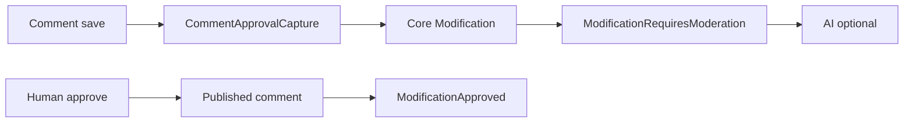

<p>&nbsp;</p>
<p align="center">
	<a href="https://github.com/swolley" target="_blank">
		
    </a>
</p>
<p>&nbsp;</p>
<p align="center">
    
    
    
</p>
<p>&nbsp;</p>

# Laraplate Content Management Module

> ⚠️ **Caution**: This package is a **work in progress**. **Don't use this in production or use at your own risk**—no guarantees are provided... or better yet, collaborate with me to create the definitive Laravel boilerplate; that's the right place to instroduce your ideas. Let me know your ideas...

Content management: entities, presets, contents, categories, comments, media, and related Filament resources.

## Documentation

| Topic | Document |
|-------|----------|
| **Comment moderation** (capture, context builder, approval flow) | [docs/COMMENT_MODERATION.md](docs/COMMENT_MODERATION.md) |
| **Cross-module event bus** (moderation + search indexing overview) | [Modules/Core/docs/EVENT_ORCHESTRATION.md](../Core/docs/EVENT_ORCHESTRATION.md) |
| **AI moderation** (listener, job, config) | [Modules/AI/docs/MODERATION.md](../AI/docs/MODERATION.md) |
| **CMS graph provider** (content graph defaults and edge labels) | [Modules/Core/docs/GRAPH_SYSTEM.md](../Core/docs/GRAPH_SYSTEM.md) |
| **Bulk imports** (`cms:import`, external plugins, dry-run boundary) | [docs/IMPORTS.md](docs/IMPORTS.md) |

## Comment moderation (summary)



CMS registers `CommentModerationContextBuilder` on Core’s `ModerationContextBuilderRegistry`; AI resolves it at runtime without importing CMS classes.

## Bulk imports

CMS exposes the module-owned `cms:import` command while Core supplies its common command mechanics. The command accepts only importers implementing the CMS marker contract, so selecting the command also fixes the destination domain. Source access and mapping remain in external plugins; CMS retains its content DTOs, pipeline, upserters, and post-processing.

See [docs/IMPORTS.md](docs/IMPORTS.md) for options, Naxos examples, dry-run guarantees, and extension rules.

## Search indexing

CMS content search indexes relation data for contributors, categories, tags, and locations. Public filters may use the schema-declared dot paths exposed by Core search, for example `tags.id`, `categories.slug`, or `locations.country`.

These filters target indexed relation fields, not arbitrary Eloquent traversal. Core translates them to Elasticsearch nested queries, Typesense nested-field filters, or database `whereHas` / `whereDoesntHave` depending on the active search driver.

A content's references (bibliography) are indexed in the content's search document as the `references` text field: each label and the URL host with the leading `www.` stripped, so searching a cited source (`Nature`, `nature.com`) finds the contents that cite it. Adding, changing or removing a reference re-sends its content. Existing indexes need a rebuild to gain the field: run `php artisan scout:sync-mapping` then `php artisan scout:reindex` for `Modules\CMS\Models\Content`.

## Public API access (anonymous reader)

The CMS `/api/v1` surface is read-only for the anonymous user once the Core `expose_api` switch is on. The `guest` role of the **`api` guard** holds `select` on exactly these CMS entities (the `guest` role of `web` holds no permission, so anonymous `/app` reads are refused):

| Entity | Default ACL | Hidden from anonymous |
|---|---|---|
| `cms_contents` | published: `valid_from <= @now` and (`valid_to >= @now` or no `valid_to`) | |
| `cms_contents_references` | relation filter: the owner content is published | |
| `vend_media` | relation filter: the owner is a CMS content that is published (morph type `Content`), so media of unpublished contents and other modules' attachments are never public | returned in the safe media projection |
| `core_taxonomies` (categories) | model scopes `valid` (the published window) and `active` (`is_active`), plus a relation filter on the entity type (`presettable` then `entity`, `type` in the CMS entity types: the table is shared with other modules, so only the CMS categories are public) | |
| `cms_tags`, `cms_locations` | none | |
| `cms_contributors` | none | `user_id`, `user`, `shared_components` |
| `cms_comments` | none (only approved comments exist as rows) | `user_id` |
| `cms_contents_ratings` | none | `user_id` |

`CMSDatabaseSeeder::defaultGuestApiGrants()` grants these and creates the ACLs only when none exists for the role and permission, so a re-seed never overwrites an ACL an operator changed. The categories ACL names scopes (Core's scope filters, `Modules/Core/docs/ACL_SYSTEM.md#scope-filters`), so the window follows `HasValidity::valid()` instead of copying it. Contents, references and media stay on column conditions on purpose: search engines never receive a scope node, so a scope in the anonymous contents ACL would be applied only when the hits are reloaded and would skew the totals and page sizes of every anonymous content search, whereas column conditions go to the engine and keep them exact. An installation seeded before scopes keeps its stored column ACL for categories (the seeder never overwrites an ACL), which keeps working. Staff roles keep their `web` permissions and read contents without a publication window. The `publisher` role (on `web`) also reads `core_settings` (public settings only) and `core_entities` (CMS types only), because related records obey their own permission and the content screens load them with a content.

A content's `cover` (the first media of the `cover` collection) is an appended attribute loaded once per result set under the media permission and ACL of the caller: on the `api` guard it is the safe media projection (URLs, dimensions, alt text; no storage details), and it is `null` when the caller may not read media or the ACL hides it. A role that reads contents and holds no `vend_media` permission sees contents without their media. Anonymous responses are cached per user and shared; CMS contents do not use the response cache, so a content that stops being valid disappears at once. See `Modules/Core/docs/rag/API_ACCESS_CONTROL.md`.

## Graph provider

CMS registers `Modules\CMS\Graph\CmsGraphProvider` as a Core Graph provider. Core still owns graph routes, traversal, authorization, request validation, and response shape. CMS only contributes content-oriented defaults: `contents` expand to `tags`, `categories`, `contributors`, and `locations` when no `relations[]` are requested; summary fields prefer editorial identifiers such as title, slug, path, status, type, and timestamps; edge labels map CMS relations to names such as `tagged_as`, `categorized_as`, `contributed_by`, and `located_at`.

Graph relation loading follows Core rules: explicit `relations[]` win, provider defaults apply only when relations are omitted, and excluded CMS implementation relations such as translations, history, modifications, locks, and media are not graph-traversable.

## Insights (map & tag graph)

The map and tag-graph surfaces (dashboard widgets and the facet alternative-selectors) get their data two different ways.

**Map — generic CRUD select, no bespoke endpoint.** The locations map is served by the ordinary list endpoint (`POST app/crud/select/cms/locations`) with a `contents` count aggregate: a column `{ "name": "contents", "type": "count" }` yields a `contents_count` on each row (via Core's dotless main-model relation-count aggregate), and the place-derived `latitude`/`longitude` accessors give the coordinates. The viewport is a `between` filter on `place.latitude`/`place.longitude`; "used" locations are those with a non-zero `contents_count` (filtered client-side). The count honours the related entity's read ACL, so it never counts contents the viewer cannot see. This is why there is no `insights/map/*` route — the CRUD layer already does it.

**Tag graph — a real endpoint.** `GET cms/insights/graph/tags` (`cms.insights.tag-graph`) returns the tag co-occurrence adjacency graph as `{ nodes, edges }`: nodes are tags weighted by how many contents use them; edges join two tags (undirected, `source < target`) weighted by how many contents they share (`Modules\CMS\Services\Graph\TagCoOccurrenceService`). This cannot be a select — the edges are a self-join over the `cms_taggables` pivot producing tag pairs, not a per-row relation count. Optional query params `minCoOccurrence` (default `1`) drops weak edges and `maxNodes` (default `200`) caps the busiest tags. Labels resolve from `cms_tags_translations`, preferring the active locale then the fallback locale, so a tag hidden by the model locale scope still gets a name.

## Graph runtime benchmark

CMS includes an opt-in benchmark for Core Graph runtime traversal over realistic content relations. The benchmark is intentionally outside the normal PHPUnit suites and is skipped unless explicitly enabled. Run it when changing Core Graph traversal/search behavior, CMS graph provider defaults, or before reopening the question of materialized graph edges, which were evaluated and not built (see `Modules/Core/docs/GRAPH_SYSTEM.md`).

```bash
CMS_GRAPH_BENCHMARK_ENABLED=true rtk php artisan test --compact Modules/CMS/tests/Benchmark/CmsGraphRuntimeBenchmarkTest.php
```

Environment variables:

| Variable | Default | Purpose |
| --- | ---: | --- |
| `CMS_GRAPH_BENCHMARK_ENABLED` | `false` | Enables the opt-in benchmark. |
| `CMS_GRAPH_BENCHMARK_CONTENTS` | `250` | Number of content records generated. |
| `CMS_GRAPH_BENCHMARK_TAGS` | `80` | Number of tags shared across contents. |
| `CMS_GRAPH_BENCHMARK_CATEGORIES` | `40` | Number of categories shared across contents. |
| `CMS_GRAPH_BENCHMARK_CONTRIBUTORS` | `40` | Number of contributors shared across contents. |
| `CMS_GRAPH_BENCHMARK_LOCATIONS` | `40` | Number of locations shared across contents. |
| `CMS_GRAPH_BENCHMARK_ITERATIONS` | `5` | Iterations per benchmark scenario. |

The benchmark reports per-scenario duration, query count, peak memory, node count, edge count, truncation, and ACL filtering. Treat it as performance evidence, not as a normal pass/fail feature test.

## License

CMS Module is open-sourced software licensed under the [GNU AGPL v3](https://www.gnu.org/licenses/agpl-3.0.html).

Copyright (c) 2025 Marco P. The full licence text is in [LICENSE](LICENSE).
